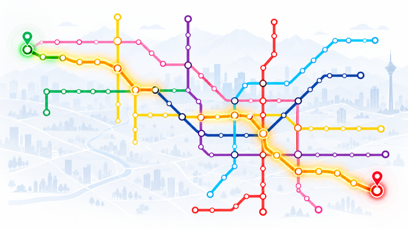
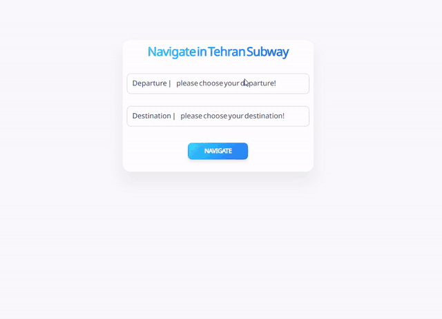

# 🚇 Tehran Subway Route Finder

**A graph-based navigation application for finding routes between Tehran subway stations using Dijkstra's shortest-path algorithm.**

Tehran Subway Route Finder is a web application developed to simulate navigation across the Tehran subway network. Based on the 2023 subway map published by the Tehran Municipality, the application models stations and connections as a graph and calculates a route between a selected departure station and destination.

 

## ✨ Features

- 🗺️ **Tehran Subway Network:** Represents the subway network based on the 2023 map published by the Tehran Municipality.
- 🧭 **Shortest-Path Calculation:** Uses Dijkstra's algorithm to find a shortest route between two stations.
- 🔽 **Interactive Station Selection:** Choose departure and destination stations from dropdown menus.
- 📍 **Step-by-Step Route:** Displays the sequence of stations to pass through to reach the destination.
- ⚖️ **Weighted Graph Support:** Supports weighted edges, allowing connections to have different costs. Currently, all edges have a weight of `1`.
- 🧩 **Graph-Based Design:** Models stations as nodes and connections between stations as edges.

 

## 🖥️ Demo

Select your departure and destination stations, and the application calculates and displays the route between them.

<!-- IMAGE PLACEHOLDER: Replace this comment with your demo GIF -->

 

## 🧠 How It Works

The application represents the Tehran subway network as a graph:

- **Nodes:** Each subway station is represented as a node.
- **Edges:** Connections between stations are represented as edges.
- **Weights:** Each edge has a weight representing its traversal cost. Currently, every edge has a weight of `1`.
- **Algorithm:** Dijkstra's algorithm determines the shortest path between the selected stations.

 
### Route Calculation

1. The user selects a departure station.
2. The user selects a destination station.
3. The application constructs or accesses the graph representation of the subway network.
4. Dijkstra's algorithm calculates the shortest path between the selected nodes.
5. The application displays the stations along the resulting route.

> **Note:** Since all edges currently have equal weights, the calculated shortest path minimizes the number of connections between stations. It does not necessarily represent the fastest real-world journey in terms of travel time, transfers, or waiting time.

 

## 🛠️ Technologies

- **C# / .NET** — Application development
- **ASP.NET Core MVC** — Web application architecture
- **Entity Framework Core** — Database access and migrations
- **Graph Data Structures** — Modeling stations and connections
- **Dijkstra's Algorithm** — Shortest-path calculation
- **SQL** — Relational data storage

